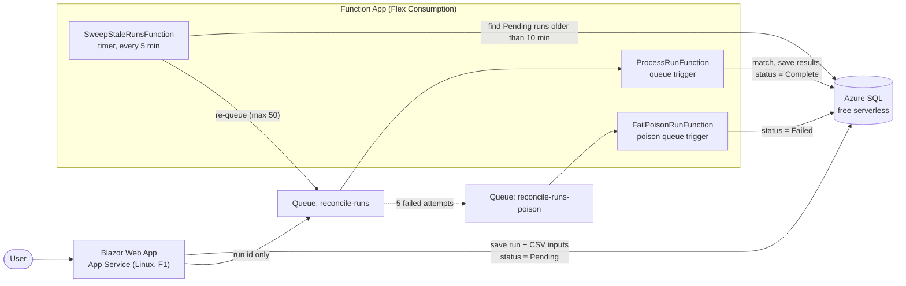
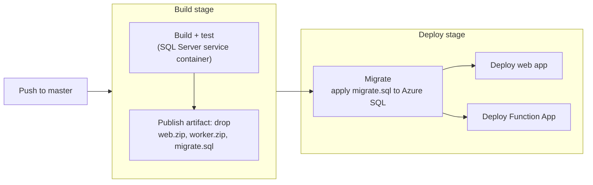

# Bank Reconciliation

A web app that reconciles bank transactions against a ledger: import two CSV files, let the matching engine pair them up, then review the matches and the exceptions. Built with ASP.NET (Blazor), EF Core and Azure.

**Live demo:** https://app-recon-mattl.azurewebsites.net

> It runs on free Azure tiers, so the first load can take 30 seconds or more while the web app and database wake up. To try it, import `samples/bank.csv` and `samples/ledger.csv`.

## What it does

A simple bank transaction reconciliation tool. Compares a bank statement against an accounting ledger and matches corresponding entries. Takes 2 CSVs with the format `Date,Amount,Description` and matches transactions based on these. Two transactions with the same Date and Amount make an exact match. Fuzzy matches are made when the amounts are equal, dates are within 3 days of each other and the descriptions share at least half their words (Jaccard similarity score >= 0.5). Possible duplicates are flagged, if multiple rows in the same file have the same date, amount and a Jaccard similarity score of 1.0 then they are flagged as duplicates. The matches are then processed and a review step is used to approve or reject them. An imported run is queued and marked Pending until it is processed, then Complete or Failed.

## Architecture



An import saves the run and its CSV inputs in one go, marks it **Pending**, then queues a message holding only the run id. The worker loads the run from the database, matches it, and marks it **Complete**. Processing is idempotent, so a redelivered message does no harm. Messages that fail five times go to the poison queue and the run is marked **Failed**. A timer sweep re-queues runs stuck in Pending.

## Key decisions

- The exact matching pass runs before the fuzzy so a perfect match can never be stolen by a fuzzy one
- `decimal` is used for money as Microsoft documentation lists it as appropriate and this avoids having to lead with minor units.
- CSVs stored as text in SQL not Blob storage as there is a 1MB cap and `SaveChangesAsync` saves the wholerun or nothing.
- Queue messages only carry the `RunId` so that the database stays as the single source of truth.
- An idempotent worker is used so that redelivered messages do no harm.
- Runs that fail after 5 attempts are marked failed.
- A timer sweep finds pending runs older than 10 minutes and queues them.

## CI/CD



An Azure DevOps pipeline (`azure-pipelines.yml`) builds, runs the test suite against a SQL Server container, and publishes one artifact. The deploy stage first applies the idempotent EF migration script, then deploys the web app and the Function App. Deployments and migrations authenticate with a workload identity federation service connection, scoped to the one resource group, so the pipeline holds no Azure passwords.

## Tech stack

| Area | Technology |
|---|---|
| Runtime | .NET 10 (SDK pinned in `global.json`) |
| Web | ASP.NET Core Blazor Web App (Interactive Server, per page) |
| Worker | Azure Functions, isolated worker model (queue and timer triggers) |
| Data | EF Core 10 with SQL Server; Azure SQL Database (free offer) in the cloud |
| Messaging | Azure Queue Storage (Azurite locally) |
| Hosting | Azure App Service (Linux, Free) and Azure Functions Flex Consumption, Sweden Central |
| CI/CD | Azure DevOps Pipelines (YAML), Azure Repos |
| Tests | xUnit (133 tests; persistence tests use a real SQL Server) |

## Repository layout

| Path | Contents |
|---|---|
| `src/Reconciliation.Domain` | Entities, CSV parsing, the matching engine (no dependencies on the other projects) |
| `src/Reconciliation.Data` | EF Core context, migrations, run submission and processing |
| `src/Reconciliation.Web` | Blazor Web App |
| `src/Reconciliation.Worker` | Azure Functions worker |
| `tests/Reconciliation.Tests` | Unit and persistence tests |
| `docs/decisions.md` | Design decisions and known limitations |
| `samples/` | Example bank and ledger CSV files |

## Run it locally

Requirements: the .NET SDK from `global.json`, Docker, and Azure Functions Core Tools.

1. Create a `.env` file in the root folder with `MSSQL_SA_PASSWORD=<YOUR PASSWORD>`. The password must meet SQL Server's password requirements (8+ characters and at least three of: upper case, lower case, digits, symbols). Avoid `;` and `"` as the password goes into a connection string.
2. Start SQL Server and Azurite: `docker compose up -d`
3. Set `RECONCILIATION_CONNECTION` to a connection string for the local SQL container
   ```powershell
   $env:RECONCILIATION_CONNECTION = "Server=localhost,1433;Database=Reconciliation;User ID=sa;Password=<YOUR PASSWORD>;TrustServerCertificate=True"
   ```
4. In the same terminal window, restore tools and apply the migrations: `dotnet tool restore`, `dotnet restore src/Reconciliation.Data` then `dotnet ef database update --project src/Reconciliation.Data`
5. Give the web app its settings with user secrets: `ConnectionStrings:Reconciliation`. The local storage connection string is already in `appsettings.Development.json`.
   ```powershell
   dotnet user-secrets set "ConnectionStrings:Reconciliation" "Server=localhost,1433;Database=Reconciliation;User ID=sa;Password=<YOUR PASSWORD>;TrustServerCertificate=True" --project src/Reconciliation.Web
   ```
6. Create `src/Reconciliation.Worker/local.settings.json` to give the worker its settings (the file is git-ignored so you will have to create it): `ConnectionStrings__Reconciliation`, `AzureWebJobsStorage` (`UseDevelopmentStorage=true`) and `FUNCTIONS_WORKER_RUNTIME` (`dotnet-isolated`). For example:
   ```json
   {
     "IsEncrypted": false,
     "Values": {
       "AzureWebJobsStorage": "UseDevelopmentStorage=true",
       "FUNCTIONS_WORKER_RUNTIME": "dotnet-isolated",
       "ConnectionStrings__Reconciliation": "Server=localhost,1433;Database=Reconciliation;User ID=sa;Password=<YOUR PASSWORD>;TrustServerCertificate=True"
     }
   }
   ```
7. Run the worker from its folder: `dotnet run` in `src/Reconciliation.Worker`.
8. In a separate terminal, run the web app: `dotnet run --project src/Reconciliation.Web`.
9. Open the URL printed in the console (the Now listening on: line), then import `samples/bank.csv` and `samples/ledger.csv`. The run should go from Pending to Complete once the worker picks it up.
10. To stop, press Ctrl+C in both terminals, then run `docker compose down` to stop the containers. If you want to delete the data use `docker compose down -v`.

Tests: while the containers are running, set `RECONCILIATION_CONNECTION` to the local SQL container and run `dotnet test`. The tests always use a separate `Reconciliation_Tests` database, never your development data.

## Limitations and next steps

- Single currency (GBP) to avoid dealing with various currency forms.
- Amount format is plain decimals only, no thousands separators.
- No authentication.
- No delete or undo.
- Greedy fuzzy matching is deterministic but no globally optimal as later bank rows might be a better match for a ledger transaction.