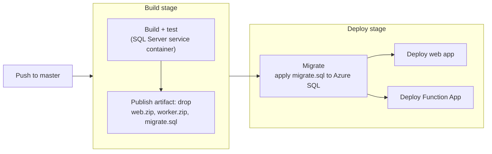

# Bank Reconciliation

A web app that reconciles bank transactions against a ledger: import two CSV files, let the matching engine pair them up, then review the matches and the exceptions. Built with ASP.NET (Blazor), EF Core and Azure.

**Live demo:** https://app-recon-mattl.azurewebsites.net

> It runs on free Azure tiers, so the first load can take 30 seconds or more while the web app and database wake up. To try it, import `samples/bank.csv` and `samples/ledger.csv`.

## What it does

<!-- TODO (your words, 4-6 lines): the CSV format, how exact then fuzzy matching works,
     possible duplicates, the review step (approve/reject), and what the run statuses mean. -->

## Architecture

An import saves the run and its CSV inputs in one go, marks it **Pending**, then queues a message holding only the run id. The worker loads the run from the database, matches it, and marks it **Complete**. Processing is idempotent, so a redelivered message does no harm. Messages that fail five times go to the poison queue and the run is marked **Failed**. A timer sweep re-queues runs stuck in Pending.

## Key decisions

<!-- TODO (5-8 bullets, each with the *why*; examples below are from docs/decisions.md):
- CSVs stored in SQL, not Blob storage: ...
- Queue message carries only the run id: ...
- Idempotent worker: ...
- EF retry because the free database pauses when idle: ...
Full list: [docs/decisions.md](docs/decisions.md) -->

## CI/CD

An Azure DevOps pipeline (`azure-pipelines.yml`) builds, runs the test suite against a SQL Server container, and publishes one artifact. The deploy stage first applies the idempotent EF migration script, then deploys the web app and the Function App. Deployments and migrations authenticate with a workload identity federation service connection, scoped to the one resource group, so the pipeline holds no Azure passwords.

## Tech stack

| Area | Technology |
|---|---|
| Runtime | .NET 10 (SDK pinned in `global.json`) |
| Web | ASP.NET Core Blazor Web App (Interactive Server, per page) |
| Worker | Azure Functions, isolated worker model (queue and timer triggers) |
| Data | EF Core 10 with SQL Server; Azure SQL Database (free offer) in the cloud |
| Messaging | Azure Queue Storage (Azurite locally) |
| Hosting | Azure App Service (Linux, Free) and Azure Functions Flex Consumption, Sweden Central |
| CI/CD | Azure DevOps Pipelines (YAML), Azure Repos |
| Tests | xUnit (133 tests; persistence tests use a real SQL Server) |

## Repository layout

| Path | Contents |
|---|---|
| `src/Reconciliation.Domain` | Entities, CSV parsing, the matching engine (no dependencies on the other projects) |
| `src/Reconciliation.Data` | EF Core context, migrations, run submission and processing |
| `src/Reconciliation.Web` | Blazor Web App |
| `src/Reconciliation.Worker` | Azure Functions worker |
| `tests/Reconciliation.Tests` | Unit and persistence tests |
| `docs/decisions.md` | Design decisions and known limitations |
| `samples/` | Example bank and ledger CSV files |

## Run it locally

> Draft: check these steps on a clean clone before publishing.

Requirements: the .NET SDK from `global.json`, Docker, and Azure Functions Core Tools.

1. Create a `.env` file with `MSSQL_SA_PASSWORD=<YOUR PASSWORD>`
2. Start SQL Server and Azurite: `docker compose up -d`
3. Restore tools and apply the migrations (set `RECONCILIATION_CONNECTION` to a connection string for the local SQL container first): `dotnet tool restore`, then `dotnet ef database update --project src/Reconciliation.Data`
4. Give the web app its settings with user secrets: `ConnectionStrings:Reconciliation` (local SQL) and `ConnectionStrings:Storage` (`UseDevelopmentStorage=true`).
5. Give the worker its settings in `src/Reconciliation.Worker/local.settings.json`: `ConnectionStrings__Reconciliation`, `AzureWebJobsStorage` (`UseDevelopmentStorage=true`) and `FUNCTIONS_WORKER_RUNTIME` (`dotnet-isolated`).
6. Run the worker from its folder: `dotnet run` in `src/Reconciliation.Worker`.
7. Run the web app: `dotnet run --project src/Reconciliation.Web`.

Tests: set `RECONCILIATION_CONNECTION` to the local SQL container and run `dotnet test`. The tests always use a separate `Reconciliation_Tests` database, never your development data.

## Limitations and next steps

<!-- TODO (short and honest). From docs/decisions.md: single currency (GBP), no authentication,
     no way to delete runs, thousands separators in amounts are not supported. Add anything
     about the free-tier cold starts, and what you'd change for production
     (managed identity for storage, a dedicated migration user, ...). -->